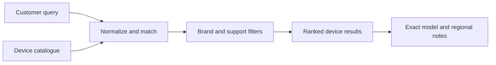

# Openline eSIM Compatibility

<!-- CUP-OF-NEWS-STYLE -->
<div align="center">

[](https://openline.com)
[](https://github.com/askopenline/openline-check)
[](https://github.com/askopenline/openline-check/releases)
[](#quick-start)
[](LICENSE)


**A fast, browser-based explorer for eSIM support across device families and regional variants.**

[Company website](https://openline.com) · [Live explorer](https://check.openline.com) · [Modal view](https://check.openline.com/modal-preview.html) · [Release history](https://github.com/askopenline/openline-check/releases) · [Contribution guide](.github/OPENLINE-CONTRIBUTING.md)

</div>

---

A fast way to explore eSIM support across device families, model codes, and regional variants. Openline's compatibility interface combines a searchable catalogue with readable notes, brand filters, and an embeddable presentation for use inside a wider customer journey.

<p align="center">
  <a href="https://check.openline.com"><strong>Open the compatibility explorer</strong></a> ·
  <a href="https://check.openline.com/modal-preview.html">Modal view</a> ·
  <a href="#what-it-does">Capabilities</a> ·
  <a href="#quick-start">Run locally</a> ·
  <a href="#catalogue-maintenance">Maintain the data</a> ·
  <a href="#languages">Languages</a> ·
  <a href="#search-and-sharing">SEO</a> ·
  <a href="#hosting-and-deployment">Hosting</a> ·
  <a href="https://github.com/askopenline/openline-check/releases">Releases</a>
</p>


---

## What it does

The application runs in the browser and does not require a backend or application build step. Its catalogue includes both curated and generated records, so the interface is a reference for investigation rather than a claim that every listed device has been independently tested.

| Capability | How it helps |
| --- | --- |
| Model and brand search | Find a family, a familiar product name, or a manufacturer model code |
| Typo-tolerant matching | Recover useful results from common spelling and naming variations |
| Brand and support filters | Narrow a large catalogue without scrolling through every entry |
| Variant notes | Keep regional, firmware, Wi-Fi-only, and carrier-lock qualifications visible |
| 33 languages | The same languages as [openline.com](https://openline.com), with a flag switcher in the top bar |
| Standalone view | Offer a focused compatibility destination |
| Modal reference | Embed the lookup inside another Openline interface |
| Static delivery | Serve the application as HTML, CSS, JavaScript, and data |

---

## The interface

This capture comes from the committed application running locally. Catalogue totals describe records in this snapshot, not the number of devices physically tested by Openline.


---

## How the lookup works




The catalogue and search implementation are deliberately separate. That makes it possible to correct a device record without redesigning the interface, or improve search behavior without silently changing compatibility data.

---

## Quick start

No package installation is required to serve the existing site. Use a local HTTP server so that the standalone and modal views behave like their hosted counterparts.

```sh
git clone https://github.com/askopenline/openline-check.git
cd openline-check
python3 -m http.server 8000 --bind 127.0.0.1
```

Open [the local explorer](http://127.0.0.1:8000) or [the modal reference](http://127.0.0.1:8000/modal-preview.html). Shared styles and fonts can require network access unless they are deliberately vendored for an offline build.

---

## Repository map

| File | Responsibility |
| --- | --- |
| [`devices.js`](devices.js) | Device catalogue and compatibility notes |
| [`app.js`](app.js) | Search, ranking, aliases, filters, and interface state |
| [`index.html`](index.html) | Standalone application (English, generated) |
| `fr/`, `de/`, `latam/`, `br/`, `tw/` … | Generated localized pages, one folder per language |
| [`i18n/`](i18n/) | Generated runtime dictionaries loaded by `app.js` |
| [`flags/`](flags/) | Flag images for the language switcher ([flag-icons](https://github.com/lipis/flag-icons), MIT) |
| [`scripts/i18n/`](scripts/i18n/) | English source strings, page template, locale list and reviewed translations |
| [`modal-preview.html`](modal-preview.html) | Embedding reference |
| [`style.css`](style.css) | Application-specific presentation |
| [`og.png`](og.png) | 1200×630 social card used by Open Graph and X |
| [`icons/`](icons/), [`favicon.ico`](favicon.ico), [`site.webmanifest`](site.webmanifest) | Favicons, Apple touch icon and installable-app icons |
| [`robots.txt`](robots.txt), [`sitemap.xml`](sitemap.xml) | Crawler rules and sitemap for check.openline.com |
| [`404.html`](404.html) | Branded not-found page in every language (generated) |
| [`scripts/`](scripts/) | Catalogue-generation and search-audit tooling |
| [`LICENSE`](LICENSE) | MIT terms and original copyright notice |

---

## Catalogue maintenance

The core fields are `brand`, `name`, `model`, `year`, `esim`, and an optional `note`. Treat the exact manufacturer model code and regional restrictions as meaningful data, not interchangeable labels.

| Review area | Acceptance question |
| --- | --- |
| Evidence | Does the change cite manufacturer or carrier information for the exact variant? |
| Provenance | Is the source and review date recorded in the change description? |
| Uncertainty | Are unverified, regional, firmware, and lock-state caveats retained? |
| Duplicates | Does the new record duplicate an existing family or model-code variant? |
| Search | Can a customer find the record using its likely names and codes? |
| Regression | Do negative results, filters, and the narrow-screen layout still behave correctly? |

Some historical scripts contain workstation-specific paths or generate model variants. Inspect their inputs and outputs before running them; a larger generated catalogue is not automatically a better verified catalogue.

---

## Languages

The checker speaks the same 33 languages as [openline.com](https://openline.com), at the same paths:

English (`/`) · [Español](https://check.openline.com/es/) · [Français](https://check.openline.com/fr/) · [Deutsch](https://check.openline.com/de/) · [Italiano](https://check.openline.com/it/) · [Português](https://check.openline.com/pt/) · [日本語](https://check.openline.com/ja/) · [中文（简体）](https://check.openline.com/zh/) · [Türkçe](https://check.openline.com/tr/) · [Русский](https://check.openline.com/ru/) · [中文（繁體）](https://check.openline.com/tw/) · [Español (Latinoamérica)](https://check.openline.com/latam/) · [Português (Brasil)](https://check.openline.com/br/) · [한국어](https://check.openline.com/ko/) · [हिन्दी](https://check.openline.com/hi/) · [বাংলা](https://check.openline.com/bn/) · [Bahasa Indonesia](https://check.openline.com/id/) · [Bahasa Melayu](https://check.openline.com/ms/) · [Tiếng Việt](https://check.openline.com/vi/) · [ไทย](https://check.openline.com/th/) · [Filipino](https://check.openline.com/tl/) · [Polski](https://check.openline.com/pl/) · [Nederlands](https://check.openline.com/nl/) · [Svenska](https://check.openline.com/sv/) · [Norsk](https://check.openline.com/no/) · [Dansk](https://check.openline.com/da/) · [Suomi](https://check.openline.com/fi/) · [Čeština](https://check.openline.com/cs/) · [Română](https://check.openline.com/ro/) · [Magyar](https://check.openline.com/hu/) · [Ελληνικά](https://check.openline.com/el/) · [Українська](https://check.openline.com/uk/) · [Български](https://check.openline.com/bg/)

- **Switcher:** a flag button in the top bar opens the list of languages in their own names. The current search is kept when switching, and the choice is remembered.
- **First visit:** on the English home page, visitors whose browser prefers another supported language are sent to it once; crawlers and embeds are left alone.
- **Everything is translated:** page text, FAQ, metadata and structured data, filters, counts with correct plural forms, empty states, warning badges and their explanations, accessibility labels and the 404 page. Device names, model codes and brands stay as manufacturers write them.
- **Embeds:** use `/<lang>/?embed=1` (for example `/fr/?embed=1`) to show the modal view in another language.

### How translations are made

English in [`scripts/i18n/en.json`](scripts/i18n/en.json) is the only source. [`scripts/translate_i18n.py`](scripts/translate_i18n.py) sends it through [OpenRouter](https://openrouter.ai): a fast multilingual model drafts each language, then a different model family proofreads it as a native speaker against the English source. Every result is checked for missing keys, changed `{placeholders}`, altered HTML and incomplete plural forms before it is accepted. Accepted translations are cached with a hash of the English source, so only changed text is sent again.

```sh
# after editing scripts/i18n/en.json
OPENROUTER_API_KEY=… python3 scripts/translate_i18n.py      # translate + proofread changed languages
python3 scripts/build_i18n.py --version 25                 # regenerate pages, dictionaries, 404 and sitemap
```

Edit `scripts/i18n/index.template.html`, never the generated `index.html` or language folders. Bump `--version` on every deploy so browsers fetch the new CSS and JavaScript.

---

## Search and sharing

[check.openline.com](https://check.openline.com) is set up to be found and shared:

- Title, description, canonical URL and robots directives on every language page; the modal reference is `noindex`.
- `hreflang` alternates for all 33 languages plus `x-default`, `og:locale` and `og:locale:alternate`, and a sitemap listing every language with its alternates.
- Open Graph and X cards with a dedicated [1200×630 card](og.png) and `@askopenline` attribution.
- JSON-LD for Organization, WebSite, WebApplication (with a search action) and FAQPage, translated per language and matching the visible FAQ.
- Shareable searches in any language: [check.openline.com/?q=pixel+9](https://check.openline.com/?q=pixel+9) or [check.openline.com/fr/?q=pixel+9](https://check.openline.com/fr/?q=pixel+9) open with results, and the address bar follows the search.
- Self-hosted favicons, Apple touch icon, web manifest, `robots.txt` and `sitemap.xml`.

---

## Hosting and deployment

The production explorer is served at **[check.openline.com](https://check.openline.com)**, with the embeddable reference at [check.openline.com/modal-preview.html](https://check.openline.com/modal-preview.html).

| Layer | Setup |
| --- | --- |
| Host | Fly.io app `openline-check`, one always-on machine in Paris (`cdg`) |
| Server | Caddy serving the static files with gzip/zstd, no-cache HTML and short-lived JS/CSS caching |
| Source | The machine downloads a pinned commit of this repository at boot; `scripts/` is not served |
| Domain | `check.openline.com` on Cloudflare DNS (DNS only), TLS issued by Fly via Let's Encrypt |
| Fallback | [openline-check.fly.dev](https://openline-check.fly.dev) |

GitHub is the source of truth. Pushing to `main` does not change production by itself: a release is published by pointing the Fly machine at the new commit and restarting it, then checking the live pages.

---

## Integration notes

Use [`modal-preview.html`](modal-preview.html) as the starting reference for embedding, and review shared stylesheet URLs when integrating with another Openline surface. Test focus management, scrolling, container dimensions, filter interactions, and how the modal returns the customer to the surrounding journey.

When updating a shared asset, verify the company-hosted bytes and the consuming page rather than assuming a cache refresh. A repository release, a hosting deployment on [check.openline.com](https://check.openline.com), and an update to an existing embed on [openline.com](https://openline.com) are separate actions.

---

## Compatibility boundary

Matching a row does not guarantee that a particular handset, firmware build, carrier-locked device, or Openline plan will work. Confirm the exact model and region before a purchase or support decision, especially for records marked as unverified.

This repository's documentation and ownership changes do not independently validate every record. Catalogue corrections are welcome through [company repository issues](https://github.com/askopenline/openline-check/issues), with evidence and without personal device identifiers.

---

## Design and technology choices

### Separate catalogue and interface

Device data and lookup behavior can be corrected independently, making a record change easier to distinguish from a search regression.

### Static by design

A browser-based catalogue is easy to host and embed without introducing an unnecessary application backend. The trade-off is that data updates require a reviewed publication.

### Exact variants matter

A familiar device-family name is not enough to settle regional, firmware, or lock-state differences. Model-code notes remain part of the answer.

---

## Maintenance, releases, and license

See the [company changelog](OPENLINE-CHANGELOG.md), [releases](https://github.com/askopenline/openline-check/releases), and [contribution guide](.github/OPENLINE-CONTRIBUTING.md) for the maintained company edition. Use the [security guide](.github/OPENLINE-SECURITY.md) for sensitive reports. Customer questions go to [ask@openline.com](mailto:ask@openline.com) or [@askopenline](https://x.com/askopenline).

Openline maintains this project under the existing [MIT license](LICENSE). Original attribution remains intact, and third-party device names and marks retain their respective rights.
