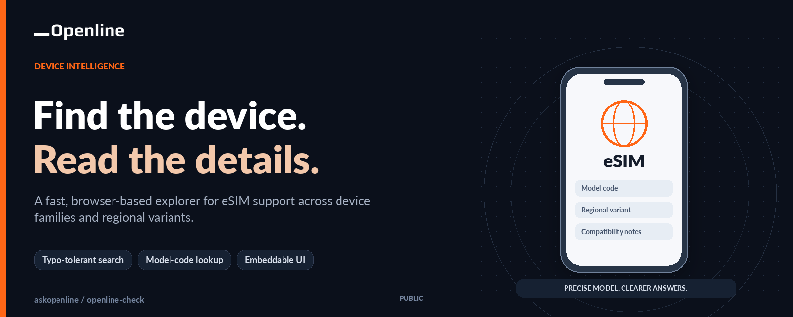
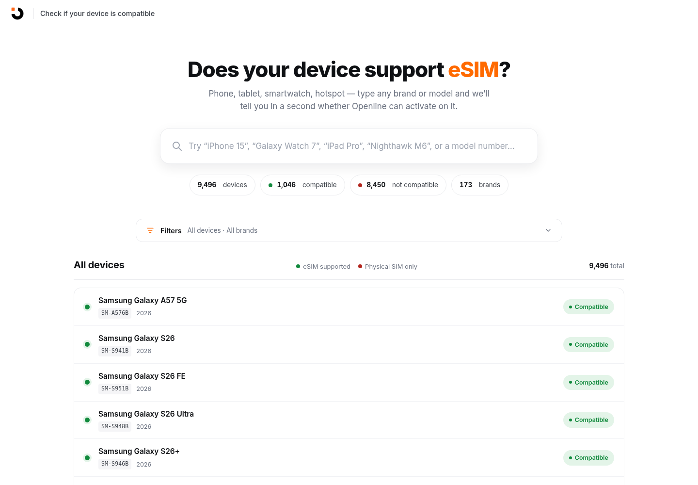
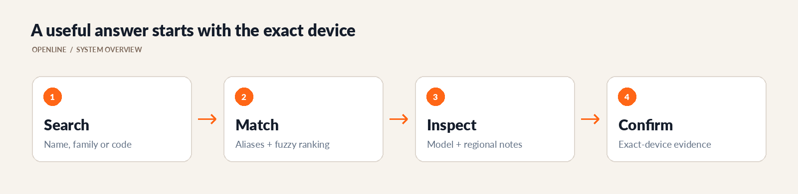
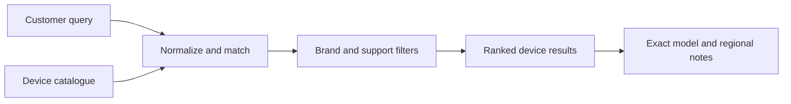

# Openline eSIM Compatibility

<!-- CUP-OF-NEWS-STYLE -->
<div align="center">

[](https://openline.com)
[](https://github.com/askopenline/openline-check)
[](https://github.com/askopenline/openline-check/releases)
[](#quick-start)
[](LICENSE)




**A fast, browser-based explorer for eSIM support across device families and regional variants.**

[Company website](https://openline.com) · [Project overview](https://openline-comp.pplx.app) · [Release history](https://github.com/askopenline/openline-check/releases) · [Contribution guide](.github/OPENLINE-CONTRIBUTING.md)

</div>

---

A fast way to explore eSIM support across device families, model codes, and regional variants. Openline's compatibility interface combines a searchable catalogue with readable notes, brand filters, and an embeddable presentation for use inside a wider customer journey.

<p align="center">
  <a href="https://openline-comp.pplx.app"><strong>Open the compatibility explorer</strong></a> ·
  <a href="#what-it-does">Capabilities</a> ·
  <a href="#quick-start">Run locally</a> ·
  <a href="#catalogue-maintenance">Maintain the data</a> ·
  <a href="https://github.com/askopenline/openline-check/releases">Releases</a>
</p>


---

## What it does

The application runs in the browser and does not require a backend or application build step. Its catalogue includes both curated and generated records, so the interface is a reference for investigation rather than a claim that every listed device has been independently tested.

| Capability | How it helps |
| --- | --- |
| Model and brand search | Find a family, a familiar product name, or a manufacturer model code |
| Typo-tolerant matching | Recover useful results from common spelling and naming variations |
| Brand and support filters | Narrow a large catalogue without scrolling through every entry |
| Variant notes | Keep regional, firmware, Wi-Fi-only, and carrier-lock qualifications visible |
| Standalone view | Offer a focused compatibility destination |
| Modal reference | Embed the lookup inside another Openline interface |
| Static delivery | Serve the application as HTML, CSS, JavaScript, and data |

---

## The interface

This capture comes from the committed application running locally. Catalogue totals describe records in this snapshot, not the number of devices physically tested by Openline.



---

## How the lookup works





The catalogue and search implementation are deliberately separate. That makes it possible to correct a device record without redesigning the interface, or improve search behavior without silently changing compatibility data.

---

## Quick start

No package installation is required to serve the existing site. Use a local HTTP server so that the standalone and modal views behave like their hosted counterparts.

```sh
git clone https://github.com/askopenline/openline-check.git
cd openline-check
python3 -m http.server 8000 --bind 127.0.0.1
```

Open [the local explorer](http://127.0.0.1:8000) or [the modal reference](http://127.0.0.1:8000/modal-preview.html). Shared styles and fonts can require network access unless they are deliberately vendored for an offline build.

---

## Repository map

| File | Responsibility |
| --- | --- |
| [`devices.js`](devices.js) | Device catalogue and compatibility notes |
| [`app.js`](app.js) | Search, ranking, aliases, filters, and interface state |
| [`index.html`](index.html) | Standalone application |
| [`modal-preview.html`](modal-preview.html) | Embedding reference |
| [`style.css`](style.css) | Application-specific presentation |
| [`scripts/`](scripts/) | Catalogue-generation and search-audit tooling |
| [`LICENSE`](LICENSE) | MIT terms and original copyright notice |

---

## Catalogue maintenance

The core fields are `brand`, `name`, `model`, `year`, `esim`, and an optional `note`. Treat the exact manufacturer model code and regional restrictions as meaningful data, not interchangeable labels.

| Review area | Acceptance question |
| --- | --- |
| Evidence | Does the change cite manufacturer or carrier information for the exact variant? |
| Provenance | Is the source and review date recorded in the change description? |
| Uncertainty | Are unverified, regional, firmware, and lock-state caveats retained? |
| Duplicates | Does the new record duplicate an existing family or model-code variant? |
| Search | Can a customer find the record using its likely names and codes? |
| Regression | Do negative results, filters, and the narrow-screen layout still behave correctly? |

Some historical scripts contain workstation-specific paths or generate model variants. Inspect their inputs and outputs before running them; a larger generated catalogue is not automatically a better verified catalogue.

---

## Integration notes

Use [`modal-preview.html`](modal-preview.html) as the starting reference for embedding, and review shared stylesheet URLs when integrating with another Openline surface. Test focus management, scrolling, container dimensions, filter interactions, and how the modal returns the customer to the surrounding journey.

When updating a shared asset, verify the company-hosted bytes and the consuming page rather than assuming a cache refresh. A repository release, a hosting deployment, and an update to an existing embed are separate actions.

---

## Compatibility boundary

Matching a row does not guarantee that a particular handset, firmware build, carrier-locked device, or Openline plan will work. Confirm the exact model and region before a purchase or support decision, especially for records marked as unverified.

This repository's documentation and ownership changes do not independently validate every record. Catalogue corrections are welcome through [company repository issues](https://github.com/askopenline/openline-check/issues), with evidence and without personal device identifiers.

---

## Design and technology choices

### Separate catalogue and interface

Device data and lookup behavior can be corrected independently, making a record change easier to distinguish from a search regression.

### Static by design

A browser-based catalogue is easy to host and embed without introducing an unnecessary application backend. The trade-off is that data updates require a reviewed publication.

### Exact variants matter

A familiar device-family name is not enough to settle regional, firmware, or lock-state differences. Model-code notes remain part of the answer.

---

## Maintenance, releases, and license

See the [company changelog](OPENLINE-CHANGELOG.md), [releases](https://github.com/askopenline/openline-check/releases), and [contribution guide](.github/OPENLINE-CONTRIBUTING.md) for the maintained company edition. Use the [security guide](.github/OPENLINE-SECURITY.md) for sensitive reports.

Openline maintains this project under the existing [MIT license](LICENSE). Original attribution remains intact, and third-party device names and marks retain their respective rights.
